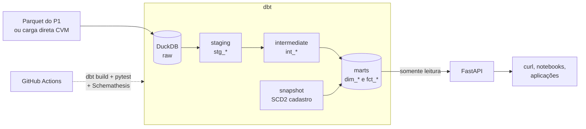
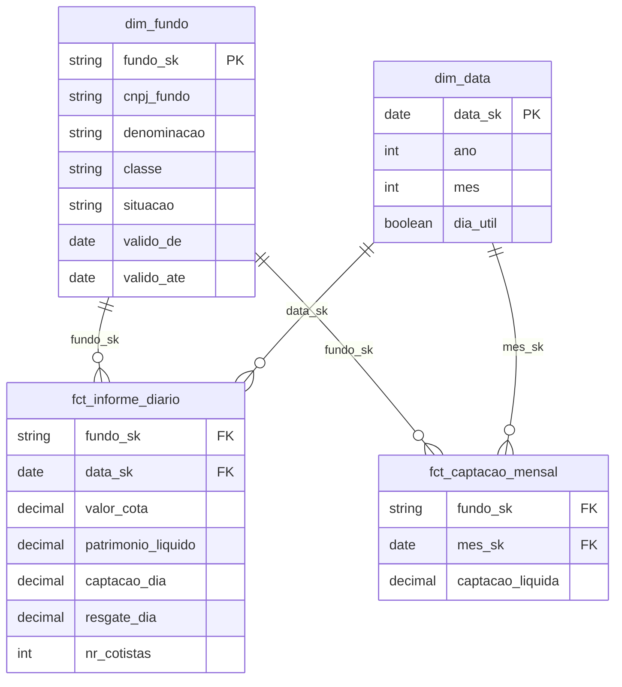

# dbt-dw-api

[](https://github.com/thalesreiser/dbt-dw-api/actions/workflows/ci.yml)


> Data warehouse dimensional modelado com **dbt** sobre **DuckDB**, com testes de qualidade, histórico de mudanças (SCD tipo 2) e documentação com linhagem, exposto por uma **API REST** somente leitura em **FastAPI** com contrato OpenAPI testado.

**Status:** 🚧 em desenvolvimento · Épico 1 de 7 (Fundações)

---

## Por que este projeto existe

Dados limpos num bucket ainda não são um produto. Para que analistas e aplicações confiem neles, é preciso um **modelo** (o que é um fato, o que é uma dimensão, qual a granularidade), **testes** que falham quando o dado está errado, **documentação** que mostra de onde cada número vem e uma **interface** estável para consumo.

Este projeto pega os dados de fundos de investimento da CVM (vindos do [P1](https://github.com/thalesreiser/aws-fundos-pipeline) ou carregados direto da fonte) e entrega exatamente isso, sem nenhum custo recorrente.

## Arquitetura



| Camada dbt | Responsabilidade | Materialização |
|---|---|---|
| `staging` | Renomear, tipar e padronizar cada fonte (1 modelo por fonte) | view |
| `intermediate` | Junções e regras de negócio reutilizáveis | ephemeral |
| `marts` | Dimensões e fatos prontos para consumo | table / incremental |

## Modelo dimensional

Esquema estrela (Kimball). Cada fato tem uma granularidade explícita:



| Fato | Granularidade |
|---|---|
| `fct_informe_diario` | 1 linha por fundo por dia |
| `fct_captacao_mensal` | 1 linha por fundo por mês |

**Regras de negócio:** captação líquida = captações − resgates no período (RN-01); valores em BRL e datas convertidas para UTC-3 só na apresentação (RN-02).

### Histórico com SCD tipo 2

Quando um fundo muda de nome, classe ou situação no cadastro, o `dbt snapshot` **não sobrescreve** o registro: fecha a versão antiga (`valido_ate`) e abre uma nova. Assim, um fato de 2024 continua apontando para o fundo como ele era em 2024.

## API

Documentação interativa em `http://localhost:8000/docs` (Swagger), gerada a partir da OpenAPI.

| Método | Rota | Descrição | Req. |
|---|---|---|---|
| GET | `/v1/fundos` | Lista fundos com filtros (ex.: situação) e paginação | RF-07 |
| GET | `/v1/fundos/{cnpj}/serie` | Série temporal de cota e PL no período, ou 404 se o CNPJ não existe | RF-08 |
| GET | `/v1/rankings/captacao` | Top N fundos por captação líquida no mês | RF-09 |

```bash
curl -H "X-API-Key: $API_KEY" "localhost:8000/v1/fundos?situacao=EM%20FUNCIONAMENTO&page=1&size=20"
curl -H "X-API-Key: $API_KEY" "localhost:8000/v1/fundos/<CNPJ_DO_FUNDO>/serie?inicio=2026-01-01&fim=2026-09-30"
curl -H "X-API-Key: $API_KEY" "localhost:8000/v1/rankings/captacao?mes=2026-09&top=10"
```

Sem a chave a API responde **401**; acima do limite de requisições, **429** (RF-10).

## Qualidade em quatro níveis

| Nível | O que garante | Ferramenta |
|---|---|---|
| Dados | `unique`, `not_null`, `accepted_values`, `relationships` e regras de negócio | dbt tests + dbt_utils |
| Unitário | Regras da API | pytest |
| Integração | API sobre um warehouse de teste real | httpx |
| Contrato | Nenhuma resposta viola a OpenAPI | Schemathesis |
| Desempenho | **p95 < 300 ms** nas consultas de série | locust ou hey |

O CI falha se qualquer teste do `dbt build` falhar (RNF-02). Há também um **teste negativo**: um dado inválido inserido de propósito precisa fazer um teste falhar, para provar que os testes funcionam.

## Stack

| Camada | Tecnologia | Por quê |
|---|---|---|
| Warehouse | DuckDB (dbt-duckdb) | Custo zero, rápido, lê Parquet direto |
| Transformação | dbt Core + dbt_utils | Padrão de mercado para modelagem analítica |
| Modelagem | Kimball (estrela) | Consultas simples e performáticas |
| API | FastAPI + Pydantic + Uvicorn | OpenAPI automática e validação de entrada |
| Testes | pytest, httpx, Schemathesis | Unitário, integração e contrato |
| Container | Docker + Docker Compose | Reprodutibilidade |
| CI | GitHub Actions | `dbt build` + testes da API |

## Como rodar

**Pré-requisitos:** Docker com Docker Compose e Python 3.11.

```bash
make up                                                  # sobe warehouse + API
make build                                               # dbt build: modelos + testes
curl -H "X-API-Key: $API_KEY" localhost:8000/v1/fundos   # primeira consulta
```

Ainda sem dados do P1? Rode `python scripts/carga_direta.py` para carregar direto da CVM (R-P3-01).

Para desenvolver: `make install`, `make lint`, `make test`, `make docs` (documentação e linhagem do dbt) e `make api` (servidor com reload).

## Estrutura do repositório

```
├── dbt/
│   ├── models/staging/       # stg_* + declaração das sources
│   ├── models/intermediate/  # int_*
│   ├── models/marts/         # dim_* e fct_*
│   ├── snapshots/            # SCD2 do cadastro
│   └── tests/                # testes singulares de regra de negócio
├── src/fundos_api/           # FastAPI (somente leitura)
├── scripts/carga_direta.py   # fallback de carga sem o P1
├── tests/                    # pytest da API
├── infra/                    # Dockerfile + docker-compose
├── docs/                     # requisitos (01–06) e ADRs
└── .github/workflows/        # CI
```

## Roadmap

| Épico | Entrega | Horas | Status |
|---|---|---|---|
| 1. Fundações | Repositório, `dbt init`, perfil DuckDB, visão e requisitos | 4 h | 🚧 |
| 2. Fontes e staging | Sources com freshness, modelos `stg_`, testes básicos | 6 h | ⬜ |
| 3. Modelo dimensional | Diagrama estrela, dims, fatos, snapshot SCD2 | 10 h | ⬜ |
| 4. Qualidade e documentação | Testes de regra, descrições, `dbt docs`, teste negativo | 5 h | ⬜ |
| 5. API | FastAPI, 3 endpoints, API key, rate limit, testes | 9 h | ⬜ |
| 6. Contrato e desempenho | Schemathesis, medição de p95 | 3 h | ⬜ |
| 7. CI e publicação | Workflow completo, ADRs, docs do dbt no GitHub Pages | 3 h | ⬜ |

## Resultados medidos

| Métrica | Meta | Medido |
|---|---|---|
| `dbt build` | sem falhas | — |
| Marts documentados e testados | 100% | — |
| p95 dos endpoints de série | < 300 ms | — |

## Documentação

| Documento | Conteúdo |
|---|---|
| [01 - Visão e escopo](docs/01-visao-e-escopo.md) | Problema, objetivo, escopo e métricas de sucesso |
| [02 - Análise e priorização](docs/02-analise-e-priorizacao.md) | Requisitos (MoSCoW), regras, restrições e riscos |
| [03 - Especificação](docs/03-especificacao.md) | User stories em Gherkin e modelo de dados |
| [04 - Arquitetura](docs/04-arquitetura.md) | C4 simplificado |
| [05 - Validação](docs/05-validacao.md) | Execução dos critérios de aceite |
| [06 - Rastreabilidade](docs/06-rastreabilidade.md) | Requisito → componente → teste |
| [ADRs](docs/adr/) | DuckDB vs Athena, estrela vs tabela larga, incremental vs tabela, cache na API |

## Projetos relacionados

| # | Projeto | Foco |
|---|---|---|
| P2 | [spark-cnpj-lakehouse](https://github.com/thalesreiser/spark-cnpj-lakehouse) | Processamento distribuído com Spark e Delta Lake |
| P1 | [aws-fundos-pipeline](https://github.com/thalesreiser/aws-fundos-pipeline) | Pipeline na AWS que produz os dados consumidos aqui |
| **P3** | **dbt-dw-api** (este) | Data warehouse com dbt, qualidade de dados e API REST |

## Licença

Copyright © 2026 Thales Reiser Pedreira. **Todos os direitos reservados.**

O código pode ser lido e executado localmente para avaliação técnica; cópia, redistribuição, obras derivadas e uso comercial exigem autorização por escrito. Veja [`LICENSE`](LICENSE) e [`POLITICA-DE-USO.md`](POLITICA-DE-USO.md).

## Autor

**Thales Reiser Pedreira**, desenvolvedor Python e HPCC com experiência em DevOps e infraestrutura.
[GitHub](https://github.com/thalesreiser) · [LinkedIn](https://www.linkedin.com/in/thalesreiser/)
