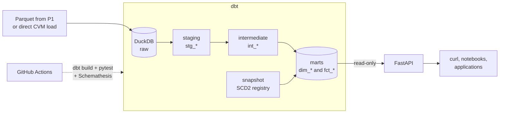
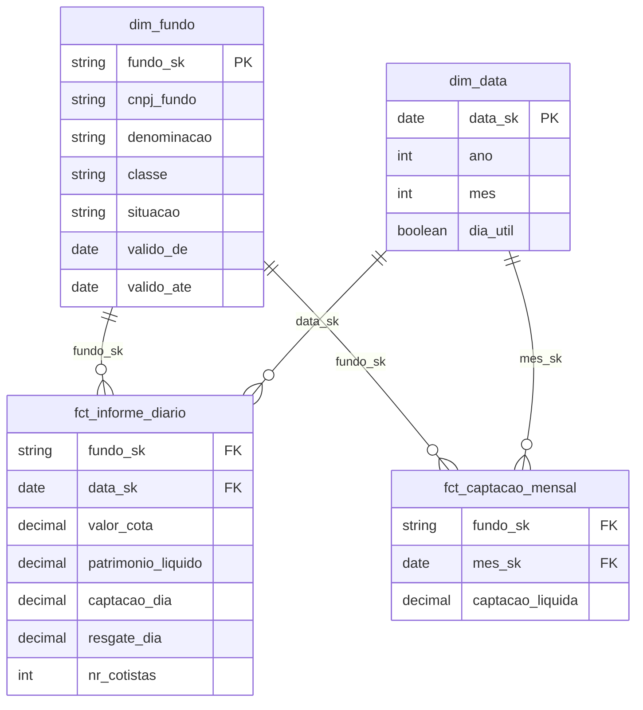

# dbt-dw-api

[](https://github.com/thalesreiser/dbt-dw-api/actions/workflows/ci.yml)


[](LICENSE)

> A dimensional data warehouse modeled with **dbt** on **DuckDB**, with data quality tests, change history (SCD type 2) and documentation with lineage, served through a read-only **FastAPI** REST API with a tested OpenAPI contract.

**Status:** 🚧 in progress · epic 1 of 7 (foundations)

---

## Why this project exists

Clean data in a bucket is not a product yet. For analysts and applications to trust it, you need a **model** (what is a fact, what is a dimension, what is the grain), **tests** that fail when the data is wrong, **documentation** that shows where every number comes from, and a stable **interface** to consume it.

This project takes the investment fund data published by CVM (the Brazilian Securities Commission), produced by [P1](https://github.com/thalesreiser/aws-fundos-pipeline) or loaded straight from the source, and delivers exactly that, with no recurring cost.

## Architecture



| dbt layer | Responsibility | Materialization |
|---|---|---|
| `staging` | Rename, type and standardize each source (one model per source) | view |
| `intermediate` | Reusable joins and business rules | ephemeral |
| `marts` | Dimensions and facts ready for consumption | table / incremental |

## Dimensional model

Star schema (Kimball). Every fact has an explicit grain:



| Fact | Grain |
|---|---|
| `fct_informe_diario` | 1 row per fund per day |
| `fct_captacao_mensal` | 1 row per fund per month |

Table and column names follow the source domain in Portuguese (`fundo` = fund, `captacao` = inflow, `cota` = share value).

**Business rules:** net inflows = inflows − redemptions in the period (RN-01); monetary values in BRL, with dates converted to UTC-3 only at presentation time (RN-02).

### History with SCD type 2

When a fund changes its name, class or status in the registry, `dbt snapshot` does **not** overwrite the record: it closes the old version (`valido_ate`) and opens a new one. A 2024 fact therefore keeps pointing to the fund as it was in 2024.

## API

Interactive documentation at `http://localhost:8000/docs` (Swagger), generated from the OpenAPI spec.

| Method | Route | Description | Req. |
|---|---|---|---|
| GET | `/v1/fundos` | Lists funds with filters (e.g. status) and pagination | RF-07 |
| GET | `/v1/fundos/{cnpj}/serie` | Time series of share value and net assets over a period, or 404 if the CNPJ does not exist | RF-08 |
| GET | `/v1/rankings/captacao` | Top N funds by net inflows in the month | RF-09 |

```bash
curl -H "X-API-Key: $API_KEY" "localhost:8000/v1/fundos?situacao=EM%20FUNCIONAMENTO&page=1&size=20"
curl -H "X-API-Key: $API_KEY" "localhost:8000/v1/fundos/<FUND_CNPJ>/serie?inicio=2026-01-01&fim=2026-09-30"
curl -H "X-API-Key: $API_KEY" "localhost:8000/v1/rankings/captacao?mes=2026-09&top=10"
```

Without the key the API returns **401**; above the rate limit, **429** (RF-10).

## Quality at every level

| Level | What it guarantees | Tool |
|---|---|---|
| Data | `unique`, `not_null`, `accepted_values`, `relationships` and business rules | dbt tests + dbt_utils |
| Unit | API rules | pytest |
| Integration | API over a real test warehouse | httpx |
| Contract | No response violates the OpenAPI spec | Schemathesis |
| Performance | **p95 below 300 ms** on time-series queries | locust or hey |

CI fails if any test in `dbt build` fails (RNF-02). There is also a **negative test**: invalid data inserted on purpose must make a test fail, proving that the tests actually work.

## Stack

| Layer | Technology | Why |
|---|---|---|
| Warehouse | DuckDB (dbt-duckdb) | Zero cost, fast, reads Parquet directly |
| Transformation | dbt Core + dbt_utils | Industry standard for analytics modeling |
| Modeling | Kimball (star schema) | Simple, fast queries |
| API | FastAPI + Pydantic + Uvicorn | Automatic OpenAPI and input validation |
| Tests | pytest, httpx, Schemathesis | Unit, integration and contract |
| Container | Docker + Docker Compose | Reproducibility |
| CI | GitHub Actions | `dbt build` + API tests |

## How to run

**Prerequisites:** Docker with Docker Compose and Python 3.11.

```bash
make up                                                  # start the warehouse + API
make build                                               # dbt build: models + tests
curl -H "X-API-Key: $API_KEY" localhost:8000/v1/fundos   # first query
```

No data from P1 yet? Run `python scripts/direct_load.py` to load straight from CVM (R-P3-01).

For development: `make install`, `make lint`, `make test`, `make docs` (dbt documentation and lineage) and `make api` (server with reload).

## Repository layout

```
├── dbt/
│   ├── models/staging/       # stg_* + source declarations
│   ├── models/intermediate/  # int_*
│   ├── models/marts/         # dim_* and fct_*
│   ├── snapshots/            # SCD2 of the registry
│   └── tests/                # singular business rule tests
├── src/fundos_api/           # FastAPI (read-only)
├── scripts/direct_load.py    # fallback load without P1
├── tests/                    # API pytest suite
├── infra/                    # Dockerfile + docker-compose
├── docs/                     # requirements (01–06) and ADRs
└── .github/workflows/        # CI
```

## Roadmap

| Epic | Deliverable | Hours | Status |
|---|---|---|---|
| 1. Foundations | Repository, `dbt init`, DuckDB profile, vision and requirements | 4 h | ✅ |
| 2. Sources and staging | Sources with freshness, `stg_` models, basic tests | 6 h | ⬜ |
| 3. Dimensional model | Star diagram, dimensions, facts, SCD2 snapshot | 10 h | ⬜ |
| 4. Quality and documentation | Business rule tests, descriptions, `dbt docs`, negative test | 5 h | ⬜ |
| 5. API | FastAPI, 3 endpoints, API key, rate limit, tests | 9 h | ⬜ |
| 6. Contract and performance | Schemathesis, p95 measurement | 3 h | ⬜ |
| 7. CI and publication | Full workflow, ADRs, dbt docs on GitHub Pages | 3 h | ⬜ |

## Measured results

| Metric | Target | Measured |
|---|---|---|
| `dbt build` | no failures | — |
| Marts documented and tested | 100% | — |
| p95 of time-series endpoints | below 300 ms | — |

## Documentation

| Document | Content |
|---|---|
| [01 - Vision and scope](docs/01-vision-and-scope.md) | Problem, goal, scope and success metrics |
| [02 - Analysis and prioritization](docs/02-analysis-and-prioritization.md) | Requirements (MoSCoW), rules, constraints and risks |
| [03 - Specification](docs/03-specification.md) | User stories in Gherkin and data model |
| [04 - Architecture](docs/04-architecture.md) | Simplified C4 |
| [05 - Validation](docs/05-validation.md) | Acceptance criteria execution |
| [06 - Traceability](docs/06-traceability.md) | Requirement → component → test |
| [ADRs](docs/adr/) | DuckDB vs Athena, star schema vs wide table, incremental vs table, API cache |

## Related projects

| # | Project | Focus |
|---|---|---|
| P2 | [spark-cnpj-lakehouse](https://github.com/thalesreiser/spark-cnpj-lakehouse) | Distributed processing with Spark and Delta Lake |
| P1 | [aws-fundos-pipeline](https://github.com/thalesreiser/aws-fundos-pipeline) | AWS pipeline that produces the data consumed here |
| **P3** | **dbt-dw-api** (this one) | Data warehouse with dbt, data quality and a REST API |

## License

Code under the [MIT](LICENSE) license: it may be used, copied and modified, including commercially, as long as the copyright notice of **Thales Reiser Pedreira** is kept. Rules about data, security and API usage are in [`USAGE-POLICY.md`](USAGE-POLICY.md).

## Author

**Thales Reiser Pedreira**, Data and Software Engineer · Python, SQL, AWS and Big Data.
[GitHub](https://github.com/thalesreiser) · [LinkedIn](https://www.linkedin.com/in/thalesreiserpedreira)
