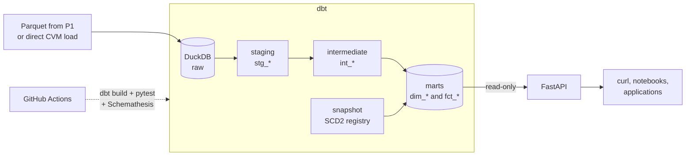
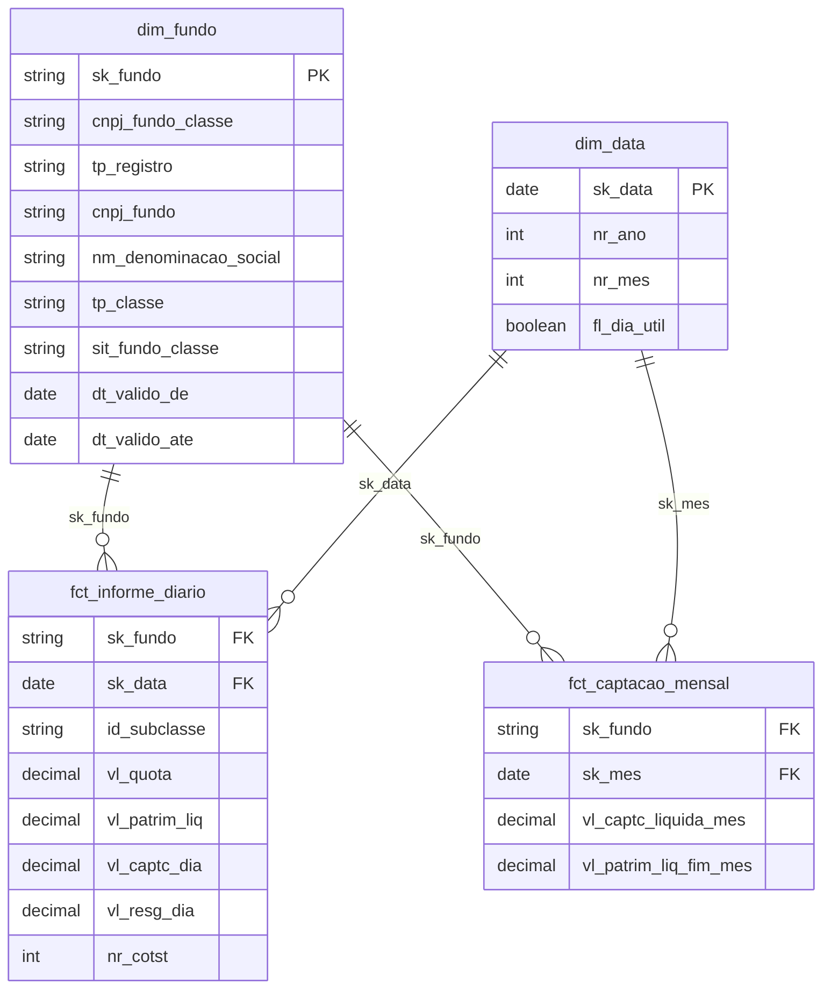

# dbt-dw-api

[](https://github.com/thalesreiser/dbt-dw-api/actions/workflows/ci.yml)


[](LICENSE)

> A dimensional data warehouse modeled with **dbt** on **DuckDB**, with data quality tests, change history (SCD type 2) and documentation with lineage, served through a read-only **FastAPI** REST API with a tested OpenAPI contract.

**Status:** 🚧 in progress · epic 1 of 7 (foundations)

---

## Why this project exists

Clean data in a bucket is not a product yet. For analysts and applications to trust it, you need a **model** (what is a fact, what is a dimension, what is the grain), **tests** that fail when the data is wrong, **documentation** that shows where every number comes from, and a stable **interface** to consume it.

This project takes the investment fund data published by CVM (the Brazilian Securities Commission), produced by [P1](https://github.com/thalesreiser/aws-fundos-pipeline) or loaded straight from the source, and delivers exactly that, with no recurring cost.

## Architecture



| dbt layer | Responsibility | Materialization |
|---|---|---|
| `staging` | Rename, type and standardize each source (one model per source) | view |
| `intermediate` | Reusable joins and business rules | ephemeral |
| `marts` | Dimensions and facts ready for consumption | table / incremental |

Model names, column prefixes (`id_`, `cnpj_`, `dt_`, `vl_`, `nr_`, `tp_`, `sit_`, `fl_`, `nm_`...)
and types follow one convention across layers: [docs/naming-conventions.md](docs/naming-conventions.md) (RNF-05).

### Staging models (RF-02)

One view per source, renamed, typed and standardized; documented and tested in
[`_stg_cvm__models.yml`](dbt/models/staging/_stg_cvm__models.yml). Grain and deduplication:
[ADR 006](docs/adr/006-staging-grain-and-deduplication.md).

| Model | Source | Grain | Rows (2026-09 / registry of 2026-10-17) |
|---|---|---|---|
| `stg_cvm__informe_diario` | `cvm.informe_diario` | 1 row per class/subclass per day (`cnpj_fundo_classe`, `id_subclasse`, `dt_competencia`) | 538,099 (no rows dropped) |
| `stg_cvm__cadastro_fundos` | `cvm.cadastro_fundos` | 1 row per fund registry id (`id_registro_fundo`); source has one row per fund and manager | 89,502 (from 90,646) |
| `stg_cvm__cadastro_classes` | `cvm.cadastro_classes` | 1 row per class registry id (`id_registro_classe`) | 36,865 (from 36,869) |

### Intermediate and mart models (RF-03)

Documented and tested in [`_int__models.yml`](dbt/models/intermediate/_int__models.yml) and
[`_marts.yml`](dbt/models/marts/_marts.yml); `make marts` builds them with everything upstream
(`dbt build --select +marts`, which also runs the registry snapshot).

| Model | Materialization | Grain | Rows (2026-09 / registry of 2026-10-17) |
|---|---|---|---|
| `int_fundo_classe__unificado` | view (input of the snapshot) | 1 row per reporting CNPJ (`cnpj_fundo_classe`): class rows with their fund's attributes, plus fund-only rows | 81,767 (36,857 classes + 44,910 fund-only) |
| snapshot `snp_cvm__fundo_classe` | snapshot (`check`) | 1 row per reporting CNPJ per version (SCD2) | 81,767 on the first run |
| `dim_fundo` | table | 1 row per reporting CNPJ per version (SCD2) + unknown member; key `sk_fundo` | 81,768 on the first run |
| `dim_data` | table | 1 row per calendar day, first month loaded to the end of the current year; key `sk_data` | 122 (2026-09-01 to 2026-12-31, 83 business days) |
| `fct_informe_diario` | incremental (`delete+insert` by month, [ADR 003](docs/adr/003-incremental-vs-table.md)) | 1 row per fund class (or subclass) per day; FKs `sk_fundo` (version valid on the date, else unknown member), `sk_data` | 538,169 (2026-08) + 538,099 (2026-09), 0 on the unknown member |
| `fct_captacao_mensal` | table | 1 row per fund class per month; net inflows (RN-01), end-of-month net assets; FKs `sk_fundo`, `sk_mes` | 25,578 per month (2026-08, 2026-09) |
| seed `feriados_nacionais` | seed | 1 row per national holiday and date, 2000-2035 | 444 |

`fl_dia_util` in `dim_data` excludes weekends and the national holidays of the seed, which is
generated from the rules in law by [`scripts/generate_national_holidays.py`](scripts/generate_national_holidays.py)
(fixed dates plus Easter-based Carnival, Good Friday and Corpus Christi, as in the national
financial calendar); state and municipal holidays are out of scope.

## Dimensional model

Star schema (Kimball, [ADR 002](docs/adr/002-star-schema-vs-wide-table.md)). Every fact has an explicit grain; the full design (measures, additivity, keys, class-or-fund resolution) is in [docs/dimensional-model.md](docs/dimensional-model.md):



| Model | Grain |
|---|---|
| `fct_informe_diario` | 1 row per fund class (or subclass) per day |
| `fct_captacao_mensal` | 1 row per fund class per month |
| `dim_fundo` | 1 row per reporting CNPJ (class, else fund without class) per version (SCD2) |
| `dim_data` | 1 row per calendar day |

Table and column names follow the source domain in Portuguese (`fundo` = fund, `captacao` = inflow, `cota` = share value).

**Business rules:** net inflows = inflows − redemptions in the period (RN-01); monetary values in BRL, with dates converted to UTC-3 only at presentation time (RN-02).

### History with SCD type 2

When a fund changes its name, class or status in the registry, `dbt snapshot` does **not** overwrite the record: it closes the old version (`dt_valido_ate`) and opens a new one. A 2024 fact therefore keeps pointing to the fund as it was in 2024.

Implemented in task 3.4 (RF-04, [ADR 007](docs/adr/007-registry-snapshot-source-and-hard-deletes.md)):
the snapshot `snp_cvm__fundo_classe` (schema `snapshots`, `check` strategy on every registry
attribute, unique key `cnpj_fundo_classe`, hard deletes not invalidated) feeds `dim_fundo`.
Each version is valid on [`dt_valido_de`, `dt_valido_ate`); the first one starts at 1900-01-01
and same-day changes collapse into the last one. History accumulates only where the DuckDB file
persists: run `make snapshot` (or `make marts`) after each `make load`; in CI the file lives for
one run, so the mechanism is proven by a simulation instead:

```bash
make snapshot   # dbt build --select +snp_cvm__fundo_classe: registry view + snapshot + tests
make scd2-sim   # on a temporary copy of the warehouse: snapshot, change one class name,
                # snapshot again, rebuild dim_fundo and assert the two versions below
```

```text
nm_denominacao_social                         | dt_valido_de | dt_valido_ate | fl_versao_atual
FIF - CLASSE ... EXPONENCIAL - RESP LIMITADA  | 1900-01-01   | 2026-10-19    | False
FIF - CLASSE ... RESP LIMITADA [SCD2 TEST]    | 2026-10-19   | None          | True
```

## API

Interactive documentation at `http://localhost:8000/docs` (Swagger), generated from the OpenAPI spec.

Run it with `make api` (or `uvicorn fundos_api.main:app`) after `make build`; it reads the marts
of `DUCKDB_PATH` in **read-only** mode and never creates the file ([ADR 004](docs/adr/004-api-direct-duckdb-vs-cache.md)).
Settings come from the environment or `.env` ([`.env.example`](.env.example)): `DUCKDB_PATH`,
`MARTS_SCHEMA` (default `marts`), `API_PREFIX` (`/v1`), `DEFAULT_PAGE_SIZE` (50) and
`MAX_PAGE_SIZE` (500, at most 1000), `API_KEY`, `RATE_LIMIT_REQUESTS` (60) and
`RATE_LIMIT_WINDOW_SECONDS` (60).

`GET /health` answers `{"status": "ok", "database": "reachable", "latest_month": "2026-09-01"}`
(latest reference month loaded), or **503** with `"status": "unavailable"` when the warehouse
is missing or cannot be read; file paths are never exposed. Invalid input (a CNPJ that is not
14 digits, `limit`/`offset` out of bounds) gives **422** before any query runs (RNF-03).
Responses carry fund and class data only: no CPF and no natural-person names (LGPD).
Unknown query parameters are ignored (they never cause an error), so filters and pagination
combine freely.

**Number format.** Monetary amounts (net assets, totals, inflows, redemptions, net inflows)
are JSON numbers rounded to 2 decimal places (`1500.25`, not `"1500.25"`); they are exact
`Decimal` values inside the API. The share value `vl_quota` is a unit price with up to 12
decimals and is a JSON number **not** rounded (`1.234567890123`), within the precision of a
JSON number (IEEE 754 double, 15-17 significant digits). Counts are integers.

| Method | Route | Description | Req. |
|---|---|---|---|
| GET | `/v1/fundos` | Lists funds with filters (e.g. status) and pagination | RF-07 |
| GET | `/v1/fundos/{cnpj}/serie` | Time series of share value and net assets over a period, or 404 if the CNPJ does not exist | RF-08 |
| GET | `/v1/rankings/captacao` | Top N funds by net inflows in the month | RF-09 |

```bash
curl -H "X-API-Key: $API_KEY" "localhost:8000/v1/fundos?situacao=em%20funcionamento%20normal&tp_fundo=FIF&limit=20&offset=0"
curl -H "X-API-Key: $API_KEY" "localhost:8000/v1/fundos/<FUND_CNPJ>/serie?inicio=2026-01-01&fim=2026-09-30"
curl -H "X-API-Key: $API_KEY" "localhost:8000/v1/rankings/captacao?mes=2026-09&top=10"
```

**API key and rate limit (RF-10).** Every `/v1/*` route requires the `X-API-Key` header;
`/health`, `/docs` and `/openapi.json` stay public (Swagger shows the lock and an *Authorize*
button). Set the key in `.env` (`API_KEY=<long random value>`, e.g. from
`python -c "import secrets; print(secrets.token_urlsafe(32))"`) and never commit it; it is
compared in constant time (`hmac.compare_digest`).

| Situation | Status | Body / headers |
|---|---|---|
| Header missing or key wrong | **401** | `{"detail": "missing X-API-Key header"}` / `{"detail": "invalid API key"}`, `WWW-Authenticate: X-API-Key` |
| More than `RATE_LIMIT_REQUESTS` (60) requests per key in `RATE_LIMIT_WINDOW_SECONDS` (60 s) | **429** | `{"detail": "rate limit exceeded"}`, `Retry-After: <seconds>` |
| `API_KEY` not set (or blank) on the server | **503** | `{"detail": "API key not configured on the server"}`: the API fails closed, never open |

The limit is a fixed window kept in process memory: it is per process, not shared across
uvicorn workers or replicas (with N workers a key gets up to N times the limit), and it resets
on restart ([ADR 004](docs/adr/004-api-direct-duckdb-vs-cache.md)). Rejected requests (401)
do not count against the limit.

**`GET /v1/fundos` (RF-07).** Current version of each fund/class in `dim_fundo`
(`fl_versao_atual`), without the unknown member, ordered by `cnpj_fundo_classe`. Filters (all
optional, combined with AND, bound parameters only): `situacao` (registry status
`sit_fundo_classe`, case-insensitive, one of `CANCELADO`, `EM ANALISE`,
`EM FUNCIONAMENTO NORMAL`, `EM LIQUIDACAO`, `EM SITUACAO ESPECIAL`, `FASE PRE-OPERACIONAL`,
`INCORPORACAO`; anything else is **422**), `tp_fundo` (e.g. `FIF`, `FIDC`) and `tp_classe`
(e.g. `CLASSES DE COTAS DE FUNDOS FIF`), exact and case-insensitive, and `nome` (substring of
the legal name, at least 3 characters) and `informa_recente` (`true`/`false`, the flag
`fl_informa_recente` of each item: the CNPJ has a daily report in the latest month loaded). **Pagination convention for the whole API:**
`limit` (default `DEFAULT_PAGE_SIZE`, at most `MAX_PAGE_SIZE`) and `offset`, and list responses
use the envelope `{"items": [...], "limit": 20, "offset": 0, "total": 1234}` with the total
number of matching rows. The registry status is shown as published by CVM: the funds that are
`CANCELADO` in the registry but still report (233 in 2026-09) are listed with
`sit_fundo_classe = "CANCELADO"`, and `situacao=CANCELADO&informa_recente=true` lists exactly
them.

`GET /v1/fundos/{cnpj}/serie` (RF-08) returns the daily points of a fund/class ordered by date
ascending: `{"cnpj_fundo_classe": ..., "inicio": "2025-09-02", "fim": "2026-09-01", "items":
[{"sk_data": "2026-09-01", "vl_quota": 1.6, "vl_patrim_liq": 110.0, ...}]}`.
`inicio` and `fim` (ISO dates, inclusive) are optional: `fim` defaults to the latest reported day
of the CNPJ and `inicio` to 12 months before it; `inicio > fim` or a period above 1,830 days
(about five years) gives **422**. Points are at class level: subclass rows are summed into their
class as in `fct_captacao_mensal` (`vl_quota` is null on a day with more than one subclass and
`id_subclasse` is null). With `por_subclasse=true` the series has one point per subclass per
day, ordered by date and subclass, each with its own `vl_quota` and `id_subclasse` (null for a
class without subclasses). A CNPJ absent from `dim_fundo` (any version) gives **404**; a
known CNPJ without reports in the period gives **200** with `"items": []`.

**`GET /v1/rankings/captacao`** (RF-09) ranks the funds/classes of a month by net inflows
(`vl_captc_liquida_mes` = inflows - redemptions, RN-01) from `fct_captacao_mensal`. Parameters:
`mes` (`YYYY-MM`, default: latest month loaded), `top` (1-100, default 10) and `ordem`
(`desc` = largest net inflows first, default; `asc` = largest net outflows first). Ties are
broken by CNPJ (ascending). Each item has `posicao`, `cnpj_fundo_classe`, the name from the
current `dim_fundo` version, `vl_captc_liquida_mes`, `vl_captc_mes`, `vl_resg_mes`,
`vl_patrim_liq_fim_mes`, `nr_cotst_fim_mes` and `nr_dias_informados`; amounts are JSON
numbers with 2 decimal places. A month without data (explicit `mes` not loaded, or an empty
warehouse) gives **404** (`{"detail": "no data for month 2026-07"}`); an
invalid `mes`, `top` or `ordem` gives **422**.

```json
{"sk_mes": "2026-09-01", "ordem": "desc", "top": 10, "items": [
  {"posicao": 1, "cnpj_fundo_classe": "<CNPJ>", "nm_denominacao_social": "<name>",
   "sk_mes": "2026-09-01", "vl_captc_mes": 20.5, "vl_resg_mes": 0.5,
   "vl_captc_liquida_mes": 20.0, "vl_patrim_liq_fim_mes": 1000.1,
   "nr_cotst_fim_mes": 7, "nr_dias_informados": 21}]}
```

## Quality at every level

| Level | What it guarantees | Tool |
|---|---|---|
| Data | `unique`, `not_null`, `accepted_values`, `relationships` and business rules | dbt tests + dbt_utils |
| Unit | API rules | pytest |
| Integration | API over a real test warehouse | httpx |
| Contract | No response violates the OpenAPI spec | Schemathesis |
| Performance | **p95 below 300 ms** on time-series queries | locust or hey |

CI fails if any test in `dbt build` fails (RNF-02). There is also a **negative test**: invalid data inserted on purpose must make a test fail, proving that the tests actually work.

**Negative tests (RF-05).** Two suites prove that the tests fail on invalid data:

```bash
make negative-tests    # 4.1: tamper rows in a copy of the built warehouse (needs `make marts`)
make negative-fixture  # 4.3: network-free, synthetic seeds; each case fails exactly its tests
```

The fixture suite covers null and duplicate keys, orphan keys (registry and fact -> dimension),
RN-01, RN-02 (negative flow, future date, date outside the reference month) and an SCD2 overlap;
the case -> failing tests table is in [docs/testing.md](docs/testing.md).

**API integration tests (task 5.6).** Unit tests (`make test`) use a hand-built synthetic DuckDB;
the integration tests build a **test warehouse with the real dbt project** from synthetic raw
rows (`tests/fixtures/warehouse/`, synthetic CNPJs only) and call every endpoint end to end with
httpx, cross-checking the values with direct queries on the marts:

```bash
make test-integration  # dbt build of the test warehouse (~1 min) + pytest -m integration
python scripts/build_test_warehouse.py --output data/test_warehouse.duckdb  # warehouse only
```

They are marked `integration`, excluded from plain `pytest` and run in the CI job
`api-integration`; details in [docs/testing.md](docs/testing.md#api-integration-tests).

## Stack

| Layer | Technology | Why |
|---|---|---|
| Warehouse | DuckDB (dbt-duckdb) | Zero cost, fast, reads Parquet directly |
| Transformation | dbt Core + dbt_utils | Industry standard for analytics modeling |
| Modeling | Kimball (star schema) | Simple, fast queries |
| API | FastAPI + Pydantic + Uvicorn | Automatic OpenAPI and input validation |
| Tests | pytest, httpx, Schemathesis | Unit, integration and contract |
| Container | Docker + Docker Compose | Reproducibility |
| CI | GitHub Actions | `dbt build` + API tests |

## How to run

**Prerequisites:** Docker with Docker Compose and Python 3.11.

```bash
pip install -e ".[dev,dbt]"                              # Python 3.11 environment
cp .env.example .env                                     # required by `make up` (API settings)
make load                                                # load a CVM month into DuckDB (below)
make build                                               # dbt build: models + tests
make up                                                  # start the API on localhost:8000
curl localhost:8000/health                               # health check
```

The API serves `/health`, `GET /v1/fundos` (RF-07), `GET /v1/fundos/{cnpj}/serie` (RF-08) and
`GET /v1/rankings/captacao` (RF-09); the `/v1/*` routes require the `X-API-Key` header and are
rate limited per key (RF-10, see [API](#api)).

**Loading the sources (RF-01).** No data from P1 yet? Load straight from the CVM open data
(R-P3-01) into `data/warehouse.duckdb` (override with `DUCKDB_PATH`), then check the sources:

```bash
make load                                     # previous reference month (~19 MB download)
make load COMPETENCIA=2026-09 COMPETENCIAS=3  # 2026-07..2026-09; reloading a month replaces it
make load-p1 P1_PATH=/path/to/p1/gold         # P1 Parquet, once available
make freshness                                # dbt source freshness
make row-counts                               # row count per source (fails if one is empty)
make staging                                  # RF-02: build the stg_ models + their tests
```

Source URLs, layouts and the registry choice after CVM Resolution 175 are in
[docs/data-source.md](docs/data-source.md) and [ADR 005](docs/adr/005-cvm-registry-after-resolution-175.md).

For development: `make install`, `make lint`, `make test`, `make docs` (dbt documentation and lineage) and `make api` (server with reload).

**Documentation and lineage (RF-06).** After `make marts` (the catalog reads the built
warehouse), generate the dbt docs, check that nothing is undocumented and open them:

```bash
make docs           # dbt docs generate -> dbt/target/{index.html,manifest.json,catalog.json}
make docs-coverage  # fails if a model, snapshot, seed, exposure or column has no description
make docs-serve     # http://localhost:8080 (lineage graph: button at the bottom right)
```

Every model, snapshot, seed and column is described in the `*.yml` files; repeated concepts
(`cnpj_fundo_classe`, SCD2 validity, RN-01) are `` blocks in `dbt/models/docs.md`, and
the API is the exposure `fundos_api`. The lineage is summarized in
[docs/dimensional-model.md](docs/dimensional-model.md#lineage). CI uploads the generated docs as
the artifact `dbt-docs` of the `sources` job (publication on GitHub Pages: task 7.3).

## Repository layout

```
├── dbt/
│   ├── models/staging/       # stg_* + source declarations
│   ├── models/intermediate/  # int_*
│   ├── models/marts/         # dim_* and fct_*
│   ├── snapshots/            # SCD2 of the registry
│   ├── macros/               # standardization helpers, schema naming, row counts
│   └── tests/                # generic (CNPJ) and singular tests, per layer
├── src/fundos_api/           # FastAPI (read-only) + ingestion helpers
├── scripts/direct_load.py    # source loader: CVM direct (fallback) or P1 Parquet
├── tests/                    # API pytest suite
├── infra/                    # Dockerfile + docker-compose
├── docs/                     # requirements (01–06) and ADRs
└── .github/workflows/        # CI
```

## Roadmap

| Epic | Deliverable | Hours | Status |
|---|---|---|---|
| 1. Foundations | Repository, `dbt init`, DuckDB profile, vision and requirements | 4 h | ✅ |
| 2. Sources and staging | Sources with freshness, `stg_` models, basic tests | 6 h | ⬜ |
| 3. Dimensional model | Star diagram, dimensions, facts, SCD2 snapshot | 10 h | ⬜ |
| 4. Quality and documentation | Business rule tests, descriptions, `dbt docs`, negative test | 5 h | ⬜ |
| 5. API | FastAPI, 3 endpoints, API key, rate limit, tests | 9 h | ⬜ |
| 6. Contract and performance | Schemathesis, p95 measurement | 3 h | ⬜ |
| 7. CI and publication | Full workflow, ADRs, dbt docs on GitHub Pages | 3 h | ⬜ |

## Measured results

| Metric | Target | Measured |
|---|---|---|
| `dbt build` | no failures | — |
| Marts documented and tested | 100% | — |
| p95 of time-series endpoints | below 300 ms | **54 ms** on CI (2 CVM months, 20 users, 0% errors); 232 ms on a laptop ([performance](docs/performance.md)) |

## Documentation

| Document | Content |
|---|---|
| [01 - Vision and scope](docs/01-vision-and-scope.md) | Problem, goal, scope and success metrics |
| [02 - Analysis and prioritization](docs/02-analysis-and-prioritization.md) | Requirements (MoSCoW), rules, constraints and risks |
| [03 - Specification](docs/03-specification.md) | User stories in Gherkin and data model |
| [04 - Architecture](docs/04-architecture.md) | Simplified C4 |
| [05 - Validation](docs/05-validation.md) | Acceptance criteria execution |
| [06 - Traceability](docs/06-traceability.md) | Requirement → component → test |
| [Data source](docs/data-source.md) | CVM files, layouts, encoding and key mapping (RF-01) |
| [Naming conventions](docs/naming-conventions.md) | Layers, model names, column prefixes and types (RNF-05) |
| [Testing](docs/testing.md) | Negative suites: invalid data -> failing tests (RF-05) |
| [Performance](docs/performance.md) | RNF-01 load test (locust): method, environment, p50/p95/p99, how to rerun |
| [Dimensional model](docs/dimensional-model.md) | Star schema, grain of each fact, surrogate keys, class-or-fund resolution (RF-03) |
| [ADRs](docs/adr/) | DuckDB vs Athena, star schema vs wide table, incremental vs table, API cache, registry after Resolution 175, staging grain and deduplication, registry snapshot |

## Related projects

| # | Project | Focus |
|---|---|---|
| P2 | [spark-cnpj-lakehouse](https://github.com/thalesreiser/spark-cnpj-lakehouse) | Distributed processing with Spark and Delta Lake |
| P1 | [aws-fundos-pipeline](https://github.com/thalesreiser/aws-fundos-pipeline) | AWS pipeline that produces the data consumed here |
| **P3** | **dbt-dw-api** (this one) | Data warehouse with dbt, data quality and a REST API |

## Data source and attribution

Source: Comissão de Valores Mobiliários (CVM) — Portal Dados Abertos
([dados.cvm.gov.br](https://dados.cvm.gov.br)), licensed under the
[Open Database License (ODbL)](https://opendatacommons.org/licenses/odbl/1-0/).

This repository does **not** redistribute CVM data: it contains only code, a national holiday
calendar seed and synthetic test fixtures, and the data is
downloaded from the portal at run time. Results derived from CVM data remain subject to the ODbL
attribution and share-alike terms if you publish them as a database. The MIT license below
covers the code only. Details in [`USAGE-POLICY.md`](USAGE-POLICY.md).

## License

Code under the [MIT](LICENSE) license: it may be used, copied and modified, including commercially, as long as the copyright notice of **Thales Reiser Pedreira** is kept. Rules about data, security and API usage are in [`USAGE-POLICY.md`](USAGE-POLICY.md).

## Author

**Thales Reiser Pedreira**, Data and Software Engineer · Python, SQL, AWS and Big Data.
[GitHub](https://github.com/thalesreiser) · [LinkedIn](https://www.linkedin.com/in/thalesreiserpedreira)
