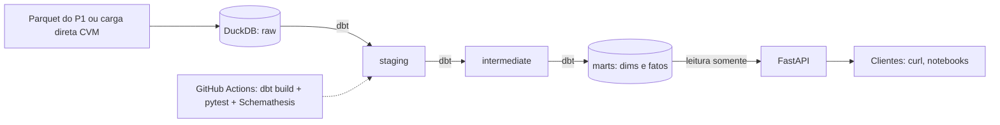

# dbt-dw-api

Data Warehouse dimensional com **dbt** + **DuckDB**, testes de qualidade e documentação, exposto por uma **API REST** (FastAPI) somente leitura. Dados de fundos de investimento da CVM.

> Status: 🚧 em desenvolvimento (Épico 1: Fundações)

## Problema
Transformar dados brutos em um modelo analítico confiável, testado e consumível por aplicações.

## Arquitetura


## Como rodar (3 comandos)
```bash
make up        # sobe warehouse + API (Docker Compose)
make build     # dbt build (modelos + testes)
curl -H "X-API-Key: $API_KEY" localhost:8000/v1/fundos
```

## Endpoints
| Método | Rota | Requisito |
|---|---|---|
| GET | `/v1/fundos` | RF-07 |
| GET | `/v1/fundos/{cnpj}/serie` | RF-08 |
| GET | `/v1/rankings/captacao` | RF-09 |

## Resultados medidos
_A preencher: p95 dos endpoints de série (meta < 300 ms)._

## Decisões
Ver [`docs/adr/`](docs/adr/).

## Limitações
_A preencher._
