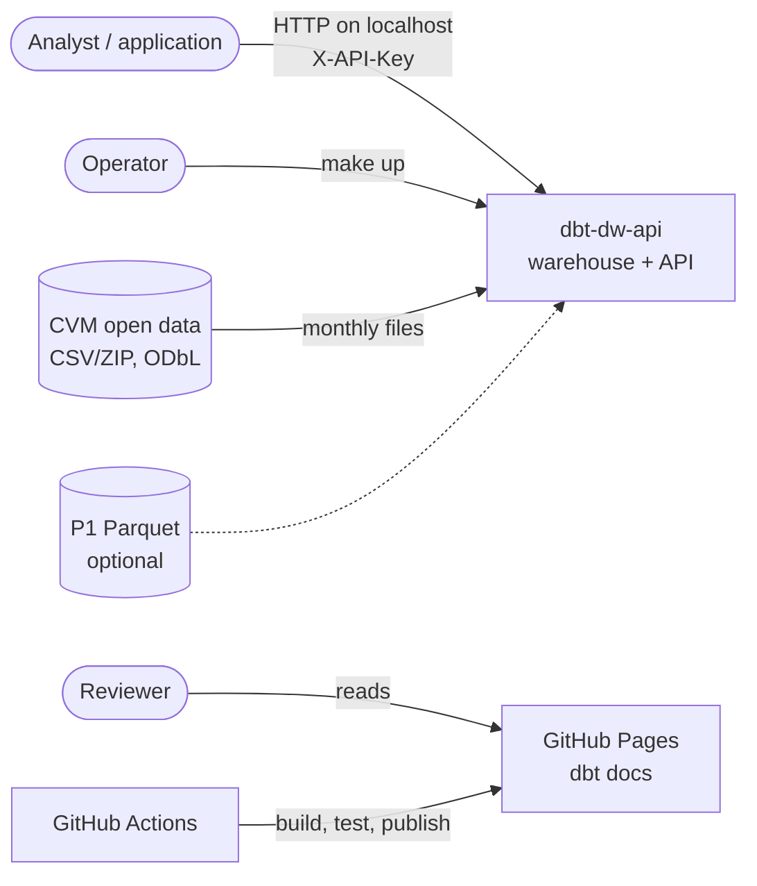
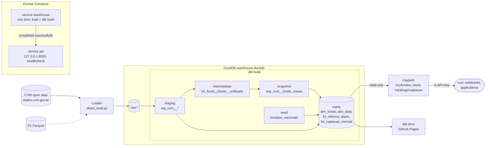

# 04 - Architecture (simplified C4)

## Context

The **analyst** (or an application) queries fund data through a read-only REST API; the
**operator** builds the warehouse from the public CVM open data and runs the environment; the
**reviewer** reads the dbt docs site and the CI results. External systems: the CVM open data
portal ([dados.cvm.gov.br](https://dados.cvm.gov.br), ODbL), optionally the P1 Parquet
(`aws-fundos-pipeline`), GitHub Actions (CI) and GitHub Pages (docs).

## Containers

| Container | Technology | Responsibility | Runs as |
|---|---|---|---|
| Loader | Python (`scripts/direct_load.py`, `fundos_api.ingestion`) | Downloads the CVM months (or reads P1 Parquet) into `raw.*`, replacing the month loaded | Compose service `warehouse` (one shot), `make load` |
| Warehouse | DuckDB file `warehouse.duckdb` ([ADR 001](adr/001-duckdb-vs-athena.md)) | Schemas `raw`, `staging`, `snapshots`, `marts` | Compose volume `warehouse` (or `data/` locally) |
| Transformation | dbt Core 1.11 + dbt-duckdb + dbt_utils | Staging, intermediate, SCD2 snapshot, marts and every data test | Compose service `warehouse` (`dbt build`), `make build` |
| API | FastAPI + Uvicorn + Pydantic | Read-only REST API over the marts, API key and rate limit ([ADR 004](adr/004-api-direct-duckdb-vs-cache.md)) | Compose service `api` on `127.0.0.1:8000`, `make api` |
| Docs site | `dbt docs generate --static` | Descriptions and lineage | GitHub Pages, workflow `docs.yml` |

Docker Compose ([`infra/docker-compose.yml`](../infra/docker-compose.yml)) runs one image
(non-root user `app`) as two services: `warehouse` loads and builds, then exits; `api` starts
only after it completed successfully (`depends_on: condition: service_completed_successfully`),
mounts the volume read-only, takes its settings from `.env` and is healthy when `/health`
answers 200.

## Components

| Layer | Components | Notes |
|---|---|---|
| raw | `raw.informe_diario`, `raw.cadastro_fundos`, `raw.cadastro_classes` | dbt sources with freshness (RF-01) |
| staging | `stg_cvm__informe_diario`, `stg_cvm__cadastro_fundos`, `stg_cvm__cadastro_classes` (views) | rename, type, deduplicate ([ADR 006](adr/006-staging-grain-and-deduplication.md)) |
| intermediate | `int_fundo_classe__unificado` (view) | class rows with fund attributes + fund-only rows ([ADR 005](adr/005-cvm-registry-after-resolution-175.md)) |
| snapshots | `snp_cvm__fundo_classe` (SCD2, `check`) | registry history ([ADR 007](adr/007-registry-snapshot-source-and-hard-deletes.md)) |
| marts | `dim_fundo`, `dim_data`, `fct_informe_diario` (incremental, [ADR 003](adr/003-incremental-vs-table.md)), `fct_captacao_mensal`; seed `feriados_nacionais` | star schema ([ADR 002](adr/002-star-schema-vs-wide-table.md)) |
| API | `main.py` (app factory), `routers/fundos.py`, `routers/serie.py`, `routers/rankings.py`, `security.py` (key + per-process limiter), `db.py` (read-only connection per request), `schemas.py`, `params.py`, `config.py` | RF-07 to RF-10; OpenAPI at `/openapi.json` (RF-11) |

## Diagram

The `warehouse` service runs the Loader and dbt; the `api` service runs FastAPI. The CI jobs that
exercise each part are listed in [05](05-validation.md).
