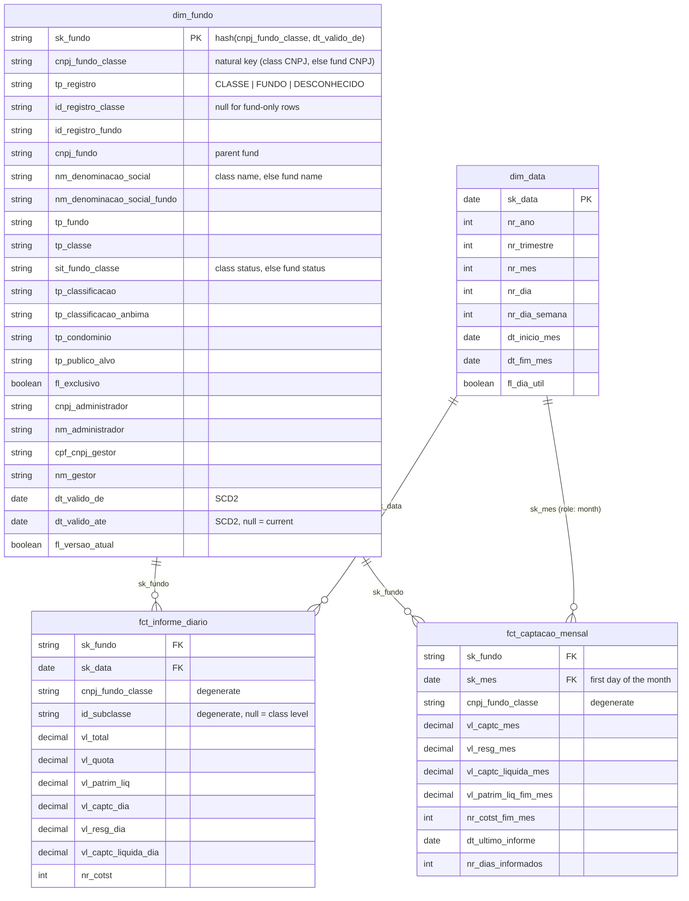

# Dimensional model (RF-03)

Design of the `marts` layer, settled before any dimension or fact is coded (task 3.1, risk
R-P3-02). The decision for a star schema is recorded in
[ADR 002](adr/002-star-schema-vs-wide-table.md). Names follow
[naming-conventions.md](naming-conventions.md). Figures were measured on 2026-10-17 with the
registry snapshot of that day and the 2026-09 daily report.

## Business questions

The model is shaped by the three API endpoints (RF-07 to RF-09) and the business rules RN-01/RN-02:

| Question | Endpoint | Served by |
|---|---|---|
| Which funds/classes exist, filtered by status, type, target investors...? | `GET /v1/fundos` (RF-07) | `dim_fundo` (current version) |
| How did the share value and net assets of a fund/class evolve over a period? | `GET /v1/fundos/{cnpj}/serie` (RF-08) | `fct_informe_diario` + `dim_fundo` + `dim_data` |
| Which funds/classes had the largest net inflows in a month? | `GET /v1/rankings/captacao` (RF-09) | `fct_captacao_mensal` + `dim_fundo` |

Net inflows = inflows − redemptions in the period (RN-01). Amounts are in BRL; dates are CVM
calendar dates (UTC-3) and are stored as `date`, without time zone (RN-02).

## Star diagram

The full column list is set when each model is coded (3.2, 3.3); the keys, grains and measures
above are fixed by this design.

## Facts

### `fct_informe_diario`

- **Grain:** one row per fund class (or subclass) per day: (`cnpj_fundo_classe`,
  `id_subclasse`, `dt_competencia`), the grain of `stg_cvm__informe_diario` (ADR 006). In the
  marts it is (`sk_fundo`, `id_subclasse`, `sk_data`). 538,099 rows in 2026-09.
- **Subclasses** are a degenerate dimension (`id_subclasse`): CVM's subclass registry is not
  loaded (ADR 005), and the daily report carries no subclass attribute besides its id. In
  2026-09, 1,023 subclass ids report under 619 CNPJs (20,184 rows). Every subclass id belongs to
  exactly one CNPJ, and a CNPJ never reports at class level and per subclass on the same day.
  So the class total of a day is the sum of its subclass rows, with no double counting.
- **Measures:**

  | Measure | Additivity | Note |
  |---|---|---|
  | `vl_captc_dia`, `vl_resg_dia` | additive (funds, subclasses, days) | |
  | `vl_captc_liquida_dia` | additive | `vl_captc_dia - vl_resg_dia` (RN-01), computed once in the fact |
  | `vl_patrim_liq`, `vl_total` | semi-additive: sum across funds/subclasses on one day, never across days (use the last day of the period) | |
  | `nr_cotst` | semi-additive, like net assets | summing across classes may count an investor more than once |
  | `vl_quota` | non-additive | per class/subclass only; returns are computed from it, not summed |

- **Foreign keys:** `sk_fundo` (the `dim_fundo` version valid on `dt_competencia`), `sk_data =
  dt_competencia`.
- **Implemented in 3.3** as an incremental model (`delete+insert` by `dt_mes_competencia`, see
  [ADR 003](adr/003-incremental-vs-table.md)); it also carries `dt_mes_competencia` and
  `_loaded_at`, which drive the reprocessing of reloaded months. `vl_captc_liquida_dia` counts a
  missing inflow or redemption as zero. 2026-08: 538,169 rows; 2026-09: 538,099; 0 rows on the
  unknown member. The version lookup uses `coalesce(dt_valido_ate, '9999-12-31')` as the
  exclusive upper bound, so it works unchanged with several versions per CNPJ (3.4).

### `fct_captacao_mensal`

- **Grain:** one row per fund class per month: (`cnpj_fundo_classe`, `dt_mes_competencia`), i.e.
  (`sk_fundo`, `sk_mes`). Subclass rows are rolled up into their class. 25,578 rows in 2026-09.
- Built from `fct_informe_diario` (not from staging), so both facts agree by construction.
- **Measures:**

  | Measure | Rule | Additivity |
  |---|---|---|
  | `vl_captc_mes`, `vl_resg_mes` | sum of the daily values in the month | additive |
  | `vl_captc_liquida_mes` | `vl_captc_mes - vl_resg_mes` (RN-01); the ranking of RF-09 orders by it | additive |
  | `vl_patrim_liq_fim_mes`, `nr_cotst_fim_mes` | value on the last reported day of the month (summed across subclasses on that day) | semi-additive |
  | `dt_ultimo_informe`, `nr_dias_informados` | last reported day; number of reported days | descriptive |

- **Foreign keys:** `sk_fundo` (the version valid on `dt_ultimo_informe`), `sk_mes` = first day
  of the month, a role of `dim_data`.
- **Implemented in 3.3** as a table: `sk_fundo` is taken from the daily row of the last reported
  day; inflows and redemptions are summed with a missing value as zero; the end-of-month values
  are those of the last reported day even when null. 25,578 rows in 2026-08 and in 2026-09; the
  singular test `assert_fct_captacao_mensal_reconciles_daily` checks it against the daily fact.

## Dimensions

### `dim_fundo`: one dimension at class grain, with fund-only rows

**Open point from ADR 005, measured on 2026-09.** The daily report key `cnpj_fundo_classe` has
25,578 distinct CNPJs (538,099 rows):

| Match | Distinct CNPJs | Rows | Distinct (CNPJ, subclass) |
|---|---|---|---|
| Class registry (`cnpj_classe`) | 25,339 (99.07%) | 535,047 | 25,758 |
| Fund registry only (`cnpj_fundo`, not a class CNPJ) | 239 (0.93%) | 3,052 | 242 |
| Unmatched | 0 | 0 | 0 |

- 25,310 of the class-matched CNPJs are also a fund CNPJ: a single-class fund keeps the fund
  CNPJ for its class (36,717 of the 36,865 registry classes). Class therefore wins over fund.
- Only 30 reported classes have a CNPJ of their own that differs from their fund's CNPJ (funds
  with several classes: 122 of 36,865 registry classes belong to a multi-class fund).
- The 239 fund-only CNPJs belong to funds with no class in the registry, all of type `FI`.
  After the one-entry-per-CNPJ rule below, 233 are `CANCELADO` in the fund registry yet still
  report in 2026-09, 4 are `EM LIQUIDACAO` and 2 `EM FUNCIONAMENTO NORMAL`. A cancelled fund that
  still reports is a CVM registry quirk to surface (the dimension shows the registry status),
  not a reason to drop the rows.
- 6 fund-only CNPJs report per subclass (9 subclass ids, 66 rows): subclass is independent of
  the class/fund decision.
- A CNPJ can have more than one registry id: 5 reported class CNPJs (3 of them with exactly one
  non-cancelled id) and 4 reported fund-only CNPJs.

**Decision.** `dim_fundo` is a single dimension whose natural key is the reporting CNPJ
(`cnpj_fundo_classe`), at class grain, with fund attributes denormalized into each class row:

- **Class rows** (`tp_registro = 'CLASSE'`): one per distinct `cnpj_classe` (36,857), with the
  attributes of the class and of its parent fund (`id_registro_fundo` is guaranteed by the
  `relationships` test in staging).
- **Fund-only rows** (`tp_registro = 'FUNDO'`): one per `cnpj_fundo` that is not a class CNPJ
  and whose fund has no class in the registry (44,910; mostly old funds that never reported
  under Resolution 175). Class columns are null. The fund CNPJ of a multi-class fund is not a
  row of its own: it is reached through `cnpj_fundo` on its class rows.
- **Unknown member** (`tp_registro = 'DESCONHECIDO'`, `cnpj_fundo_classe = '00000000000000'`):
  a fact whose CNPJ does not resolve gets this member, so facts never have orphan keys (RF-03
  acceptance). The existing warn test `assert_informe_diario_maps_to_registry` still reports
  such CNPJs (0 in 2026-09).
- **One registry entry per CNPJ:** when a CNPJ has several registry ids, keep the non-cancelled
  one, then the latest `dt_registro`, then the highest registry id. This rule lives in
  `int_fundo_classe__unificado` (ephemeral) and is tested with `unique` on
  `cnpj_fundo_classe`.
- Status and type are unified (`sit_fundo_classe`: class status, else fund status;
  `nm_denominacao_social`: class name, else fund name). The fund columns keep their own names
  (`tp_fundo`, `nm_denominacao_social_fundo`, `cnpj_fundo`) for fund-level filters.
- No bridge table is needed: every class belongs to exactly one fund, so fund to class is a
  hierarchy inside the dimension, not a many-to-many relationship. A separate fund dimension
  is not needed either: fund-level questions group `dim_fundo` by `cnpj_fundo`.

Expected size: 81,768 current rows (36,857 classes + 44,910 fund-only + 1 unknown).

**Implemented in 3.2** (`int_fundo_classe__unificado` + `dim_fundo`), with the expected 81,768
rows. "Whose fund has no class" is evaluated per CNPJ: a fund CNPJ is a fund-only row when no
registry id with that CNPJ has a class (44,910; per registry id it would be 44,912). Until 3.4
every CNPJ has one version, already following the history rules (`dt_valido_de = 1900-01-01`,
`dt_valido_ate` null, `fl_versao_atual` true), so `sk_fundo` will not change when the snapshot
takes over. Two columns were added to the diagram's list: `sit_fundo` (fund status, also on
class rows) and `dt_registro` (of the kept registry entry). Cancelled funds that still report
(233 in 2026-09) keep `sit_fundo_classe = 'CANCELADO'`; whether `GET /v1/fundos` (RF-07) lists
them under a status filter, or flags them, is decided with the API.

**History (SCD type 2, implemented in task 3.4, [ADR 007](adr/007-registry-snapshot-source-and-hard-deletes.md)).**
`int_fundo_classe__unificado` (now a view, schema `intermediate`) is snapshotted by
`snp_cvm__fundo_classe` (schema `snapshots`; `unique_key = cnpj_fundo_classe`, `check`
strategy on every attribute: names, registry ids, status, types, classifications,
administrator, manager, registration date; `invalidate_hard_deletes = false`, so a CNPJ that
leaves the registry keeps its last version open). `dim_fundo` reads the snapshot and exposes
`dt_valido_de` / `dt_valido_ate` (dates of `dbt_valid_from` / `dbt_valid_to`, null for the
current version) and `fl_versao_atual`. The registry has no history before the first snapshot,
so the **first version of each CNPJ starts at 1900-01-01**: facts older than the snapshot point
to the oldest known version instead of becoming orphans. This is a documented approximation, not
true as-of data. If the registry changes more than once on a day, the last change of the day
wins. Versions are half-open intervals [`dt_valido_de`, `dt_valido_ate`): the end of one is the
start of the next, and facts resolve with `dt >= dt_valido_de and (dt_valido_ate is null or
dt < dt_valido_ate)`. Tested: (natural key, `dt_valido_de`) unique, natural key unique among
current rows, exactly one current version per CNPJ, contiguous versions without overlaps. History
accumulates only where the DuckDB file persists; CI proves it with `make scd2-sim`.

### `dim_data`

- One row per calendar day (`sk_data`, a `date`, per the naming convention), generated with
  `dbt_utils.date_spine` from the first month loaded to the end of the current year.
- Attributes: year, quarter, month, day, weekday, first and last day of the month,
  `fl_dia_util` (weekday that is not a national holiday; holidays from a seed, task 3.2).
- **Role-playing:** `fct_captacao_mensal.sk_mes` points to the first day of the month in the same
  dimension, so no separate month dimension is needed.

**Implemented in 3.2.** The spine starts at a fixed lower bound (2000-01-01, the first year of
the holidays seed) and is cut at the first `dt_mes_competencia` loaded; it ends on 31 December
of the current year (2026-09 load: 122 days, 83 business days). Besides the attributes above it
carries `sk_mes` (= `dt_inicio_mes`, the key the monthly fact will use), `fl_fim_de_semana`,
`fl_feriado` and `nm_feriado`; `nr_dia_semana` is the ISO weekday (1 = Monday).

**Holidays.** The seed `feriados_nacionais` (2000-2035, 444 rows) is generated from the rules in
law by `scripts/generate_national_holidays.py`, not downloaded: the fixed national holidays
(Lei 662/1949 as amended by Lei 10.607/2002, Lei 6.802/1980 and, from 2024, Lei 14.759/2023 for
20 November) and the Easter-based Carnival Monday and Tuesday, Good Friday and Corpus Christi,
which are not federal holidays by law but are non-business days in the national financial
calendar (ANBIMA / B3). Limits: no state or municipal holidays, no one-off closures; the test
`assert_feriados_cover_dim_data_years` fails when `dim_data` reaches a year the seed does not
cover. Cross-check on 2026-09: the daily report has rows on 22 distinct days, the 21 business
days plus 7 September (2 rows), a holiday on which a couple of classes still reported.

## Surrogate keys

| Key | Type | Built from | Notes |
|---|---|---|---|
| `dim_fundo.sk_fundo` | `varchar` (MD5 hash) | `dbt_utils.generate_surrogate_key(['cnpj_fundo_classe', 'dt_valido_de'])` | one per version; stable across rebuilds because both inputs are stable |
| `dim_data.sk_data` | `date` | the calendar date | readable and joins without a lookup; agreed in `naming-conventions.md` |
| `fct_*.sk_fundo` | `varchar` | looked up: `cnpj_fundo_classe` = dim natural key and `dt` in [`dt_valido_de`, `coalesce(dt_valido_ate, '9999-12-31')`) | unknown member when no match |
| `fct_captacao_mensal.sk_mes` | `date` | `dt_mes_competencia` | role of `dim_data` |

The facts have no surrogate key of their own. Their natural grain is enforced with
`dbt_utils.unique_combination_of_columns`, and every foreign key gets a `relationships` test
(RF-03 acceptance: no orphans).

## Conformed columns

- `sk_fundo`, `cnpj_fundo_classe`, `sk_data` / `sk_mes` have the same name, type and meaning in
  every model that carries them.
- `cnpj_fundo_classe` is kept in both facts as a degenerate natural key: the API receives a CNPJ
  (RF-08) and can filter the fact directly. Validity and attributes still come from `dim_fundo`.
- Measure names keep the staging names and prefixes (`vl_`, `nr_`); period suffixes are `_dia`
  and `_mes`, and `_fim_mes` marks a semi-additive end-of-period value.

## Implementation plan

| Task | Models | Materialization |
|---|---|---|
| 3.2 (done) | `dim_data` + seed `feriados_nacionais`; `int_fundo_classe__unificado`; `dim_fundo` (first without history) | table / ephemeral (view from 3.4) / table |
| 3.3 (done) | `fct_informe_diario`, `fct_captacao_mensal` | incremental per [ADR 003](adr/003-incremental-vs-table.md) / table |
| 3.4 (done) | `snp_cvm__fundo_classe` and `dim_fundo` on top of it (SCD2) | snapshot / table |
